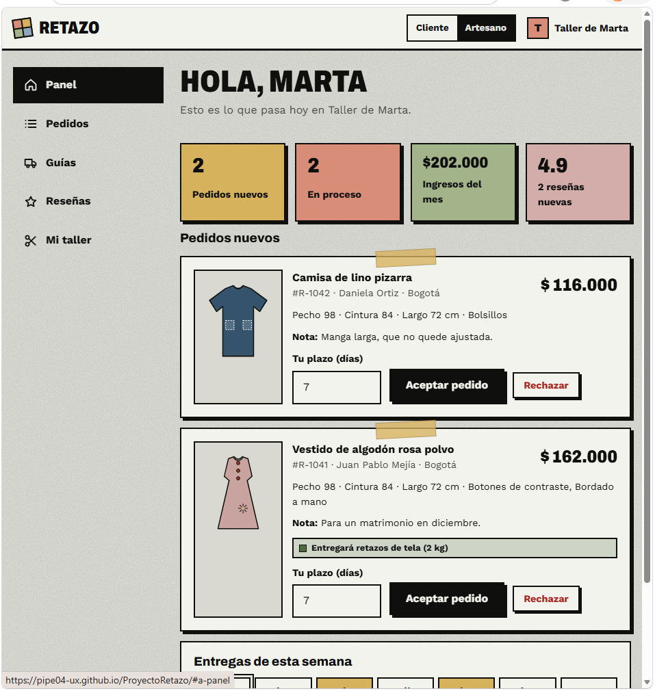
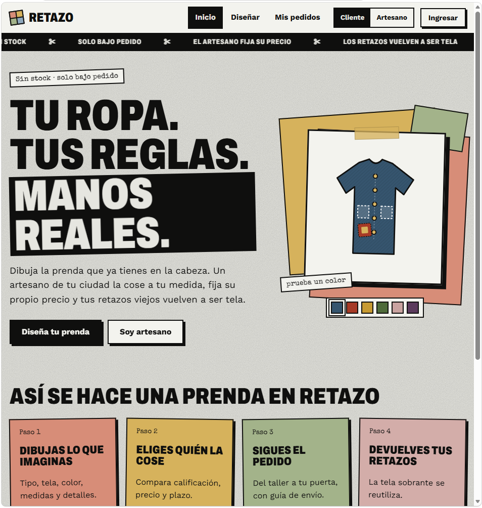
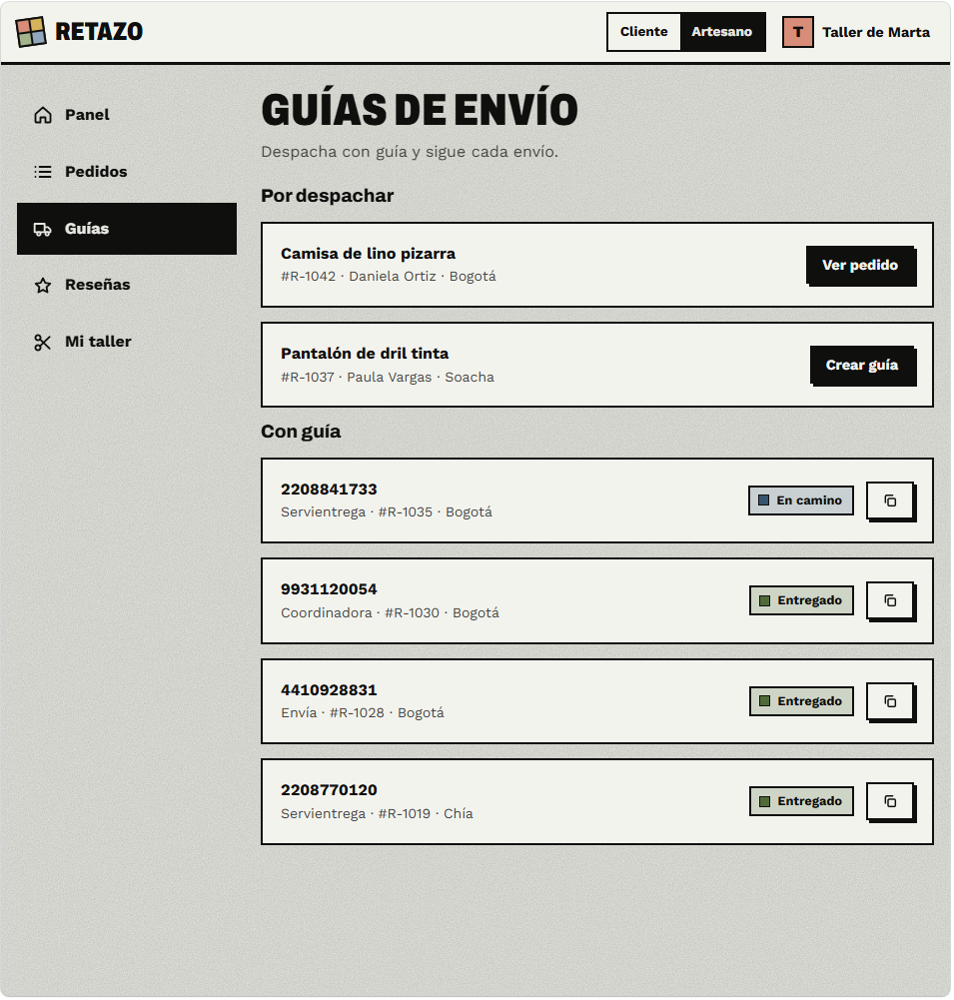

# Retazo (nombre temporal) — Moda a la medida, justa y sostenible

> Marketplace virtual de moda donde el cliente diseña lo que imagina, el artesano trabaja con autonomía y el material sobrante se recupera en lugar de desecharse.

**Estado:** Paso 4 de 4 — Prototipo funcional (v0.3)
**Demo en vivo:** https://pipe04-ux.github.io/ProyectoRetazo/
**Repositorio:** https://github.com/pipe04-ux/ProyectoRetazo
**Equipo:** Santiago Rodríguez, David Fonseca, Felipe Pinilla y Lucy Lizeth

---

## 1. Problema

La industria de la moda, y en especial la venta online masiva (tipo Shein o Temu), genera problemas que afectan a tres actores a la vez:

| Actor | Problema |
|---|---|
| **Trabajador / sastre** | Las máquinas reemplazan el oficio manual; hay explotación laboral y poca autonomía. |
| **Consumidor** | Busca algo que ya tiene en mente, pero termina comprando "algo parecido". Calidad baja, diseños masivos y repetidos (tendencias o minimalismo clásico). |
| **Medio ambiente** | Mala gestión de materiales y producción en exceso: muchos desechos textiles. |

A esto se suma un mercado que solo está pensado para vender más, no para resolver estos problemas.

## 2. Propuesta de valor

Una tienda virtual con la comodidad de Shein/Temu, pero con mecánicas distintas: **no incentiva vender más, sino hacer mejor y con propósito.**

1. **Diseño libre para el cliente:** el consumidor diseña o personaliza su prenda según lo que ya tiene en mente, en vez de escoger lo "más parecido".
2. **Trabajo autónomo para el artesano:** sastres y confeccionistas reciben pedidos, fijan sus precios y tiempos, y conservan el valor de su oficio.
3. **Recolección y reutilización de material:** los retazos y prendas viejas se recogen para reutilizarlos en nuevos diseños, reduciendo desechos.
4. **Producción bajo pedido:** se confecciona lo que se pide, así que no hay inventario sobrante ni consumo impulsivo.
5. **Mejor experiencia para ambos lados:** una interfaz sencilla para el cliente y otra para el trabajador.

## 3. Cómo funciona (flujo base)

1. El cliente entra y **diseña o elige una base** (tipo de prenda, tela, color, medidas, detalles).
2. La plataforma **asigna o deja elegir un artesano** disponible.
3. El artesano **acepta, cotiza y confecciona** (con material reciclado si el cliente lo permite).
4. Se **entrega la prenda** y se ofrece **devolver retazos o prendas viejas** para reutilización.
5. El cliente **califica** el producto y al artesano.

## 4. Usuarios

- **Cliente:** quiere prendas únicas, de buena calidad y con impacto positivo.
- **Artesano / sastre:** busca trabajo digno y autónomo.
- **Aliado de recolección:** punto o persona que recibe y clasifica material para reutilizar.

## 5. Diferenciador frente a Shein / Temu

| | Shein / Temu | Nuestra propuesta |
|---|---|---|
| Modelo | Producción masiva y stock | Bajo pedido, diseño propio |
| Diseño | El cliente elige entre lo existente | El cliente crea o personaliza |
| Trabajador | Sin autonomía visible | Autónomo, fija precio y tiempos |
| Materiales | Se desechan | Se recuperan y reutilizan |
| Incentivo | Comprar más | Comprar mejor |

## 6. Modelo de negocio (borrador)

- Comisión por cada pedido completado.
- Suscripción opcional para artesanos (visibilidad y herramientas).
- Línea de productos hechos con material reciclado.

## 7. Riesgos y preguntas abiertas

- ¿Cómo evitamos que sea "otro Shein" si crece? Hay que definir reglas claras (límites de pedidos, trazabilidad).
- ¿Cómo se garantiza la calidad entre artesanos distintos?
- ¿Cómo se organiza la recolección de material de forma realista?
- ¿Tiempos de entrega aceptables para un producto a la medida?

## 8. Hoja de ruta del taller

- [x] **Paso 1 — Idea de negocio** (este documento)
- [x] **Paso 2 — Prototipo en cartelera:** wireframes / wireflows de baja fidelidad (ver [PROTOTIPO.md](PROTOTIPO.md))
- [x] **Paso 3 — Video** con el prototipo y el recorrido del usuario
- [x] **Paso 4 — Prototipo funcional** (HTML, CSS y JS, responsive): ver la sección 11 y [CHANGELOG.md](CHANGELOG.md)
- [ ] **Siguiente ciclo:** pruebas con 3 a 5 personas usando el prototipo funcional ([docs/PRUEBAS.md](docs/PRUEBAS.md)) y nueva iteración

### Ciclo de trabajo de producto
Prototipo rápido (MVP) → Prueba de usabilidad con usuarios (método "pensar en voz alta") → Detección de puntos de fricción → Iteración del prototipo.

## 9. Trabajo en equipo con GitHub

- Rama `main`: solo versiones estables.
- Una rama por tarea o persona: `feat/nombre-tarea`.
- Commits cortos y claros: `feat: agrega pantalla de diseño`.
- Pull Request revisado por al menos otro integrante antes de unir a `main`.
- Issues y tablero (Projects) para repartir las tareas de los 4 integrantes (lista inicial en [docs/BACKLOG.md](docs/BACKLOG.md)).
- Guía completa del flujo: [CONTRIBUTING.md](CONTRIBUTING.md).

## 10. Requisitos técnicos

- Sitio **responsive** (móvil primero).
- Tecnologías: HTML, CSS y JavaScript, sin frameworks ni servidor.
- Estructura del repositorio:

```
/
├── index.html          # Punto de entrada (aplicación de una sola página)
├── css/styles.css      # Diseño, colores y modo oscuro
├── js/
│   ├── data.js         # Datos de ejemplo, precios y estado compartido (localStorage)
│   ├── garment.js      # Dibujo SVG de la prenda según el diseño
│   └── app.js          # Rutas, pantallas y acciones
├── docs/
│   ├── ARQUITECTURA.md # Cómo está hecho el código
│   ├── DISENO.md       # Colores, tipografías y contraste
│   ├── PRUEBAS.md      # Guion de pruebas de usabilidad y registro de fallos
│   └── BACKLOG.md      # Tareas pendientes para crear como Issues
├── .github/            # Plantillas de Issues y Pull Requests
├── PROTOTIPO.md        # Pasos 2, 3 y 4
├── CHANGELOG.md        # Qué cambió en cada versión
├── CONTRIBUTING.md     # Cómo trabajamos en equipo
├── LICENSE             # Licencia MIT
└── README.md
```

## 11. Prototipo funcional

**Cómo verlo:** abre `index.html` en el navegador, o publícalo con GitHub Pages (Settings → Pages → rama `main`, carpeta `/ (root)`) y comparte el enlace o su código QR.

**Qué hace:**
- **Cliente (11 pantallas):** inicio, cuenta, diseñador con vista previa en vivo, elección de artesano, datos de envío, resumen, pago (tarjeta, PSE o Nequi), recibo, seguimiento con guía, recolección de retazos y mis pedidos.
- **Artesano (6 pantallas):** panel, pedidos con filtros, detalle del pedido con cambio de estado, guías de envío, reseñas con respuesta y configuración de su taller (disponibilidad, plazo y precios).
- **Estado compartido:** cliente y artesano usan los mismos datos. Cuando el artesano acepta, confecciona, despacha con guía o entrega un pedido, el cliente lo ve de inmediato en su seguimiento. Al entregarse, el cliente puede calificar y el artesano responde.
- **Pagos de prueba:** una tarjeta que empiece por `0000` simula un rechazo; `4242 4242 4242 4242` aprueba el pago.
- El botón **Reiniciar demo** (pie de página) devuelve los datos de ejemplo.

**Correcciones de flujo incluidas (revisión del prototipo de cartelera):**
1. Después de diseñar la prenda se elige al artesano.
2. Desde la elección de artesano y desde el resumen se puede editar el diseño sin perder los datos.
3. Desde el resumen se puede editar la dirección y se vuelve al resumen.
4. Si el pago falla, se puede intentar de nuevo, cambiar de método o volver al resumen.
5. El recibo lleva siempre al seguimiento del pedido.
6. Si el cliente entrega retazos, no está obligado a pasar por la pantalla de recolección: puede programarla después desde el seguimiento.
7. El cambio de estado del artesano actualiza el seguimiento del cliente.

**Diseño (v0.3):** enfoque contracultural tipo fanzine y collage de pared: bordes gruesos, sombras duras, textura de papel, cintas adhesivas y sellos de máquina de escribir. Paleta apagada y terrosa con contraste verificado (texto 13–17:1, secundario ≥ 6,8:1, todo AA). Tipografías Archivo, Work Sans y Special Elite. Modo claro y oscuro automáticos y animaciones que respetan la preferencia de movimiento reducido. El diseñador permite además una frase estampada opcional (+$10.000).

**Limitaciones conocidas (para la siguiente iteración):** no hay servidor ni pago real; los datos viven en el navegador de cada persona; no hay chat entre cliente y artesano ni mapa de puntos de recolección.
## Capturas de pantalla

Video demostrativo del flujo completo cliente: [Ver demo en video]((https://youtu.be/5PUhx1c3FQg))
Video demostrativo del flujo completo: [Ver demo en video]((https://youtu.be/8J1MvUbCzJk))


| Vista | Captura | Descripción |
| :--- | :---: | :--- |
| **Personalizador de prenda** |  | Selección de tipo de prenda, tela, color, medidas, detalles y frase estampada. |
| **Selección de artesano** |  | Listado de artesanos autónomos con tarifas y tiempos de entrega estimados. |
| **Envío y pasarela de pago** | (!Screenshot 2026-11-18 145207.png ) | Formulario de envío y validación de pago simulado (rechazo y aprobación). |
| **Panel de artesano y guía** |  | Gestión de pedidos recibidos, aceptación y asignación de número de guía. |
